# SkyPoints Member Pipeline

Splits a global loyalty-member base into per-country tables, keeps history, flattens the partner
redemption JSON feed, and quarantines bad data. The production target is Snowflake (`sql/`);
`src/skypoints` is a tested Python reference implementation of the same rules, used as the test
oracle and for local runs.

- Design: [docs/ARCHITECTURE.md](docs/ARCHITECTURE.md)
- What changed since v1.0 and why: [docs/V2_CHANGES.md](docs/V2_CHANGES.md)
- Running it on Snowflake: [docs/SNOWFLAKE_RUNBOOK.md](docs/SNOWFLAKE_RUNBOOK.md)
- Security and data residency: [docs/SECURITY_AND_RESIDENCY.md](docs/SECURITY_AND_RESIDENCY.md)

## Architecture at a glance

**Load path.** Sources are converted at the edge to one canonical CSV, landed in an all-text RAW table
(which never rejects), validated, passed through a quality gate, staged, and applied per country.

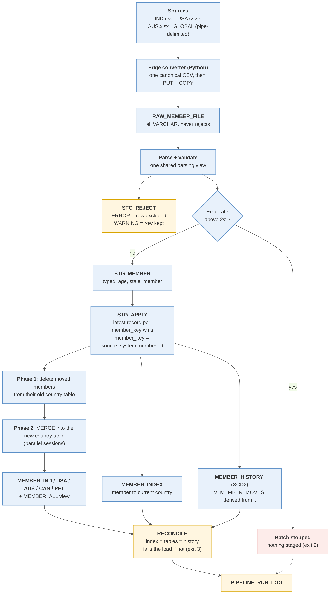

**Around the load.** Redemptions, snapshot soft-delete, the daily derived refresh, identity matching
and the offline Python-vs-Snowflake parity check.

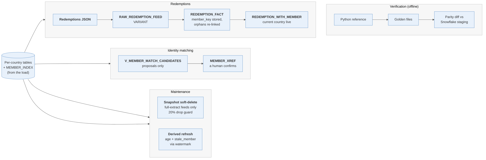

Editable diagram sources: [`asset/a_load.mmd`](asset/a_load.mmd), [`asset/b_after.mmd`](asset/b_after.mmd).

## Brief -> where it lives

| Requirement | SQL | Python |
|---|---|---|
| DDL: raw, staging, country tables | `sql/01_ddl_raw_staging.sql`, `sql/02_ddl_targets.sql` | `reference.py` (generated parts) |
| Staging load, `age`, `stale_member` (> 90 days) | `sql/03*`, `sql/05_stage_member.sql`, `sql/13_refresh_derived.sql` | `normalize.py`, `stage.py`, `derived.py` |
| Per-country split, latest record wins on moves | `sql/06_prepare_apply.sql`, `sql/07a`, `sql/07b`, `sql/08_history_index.sql` | `transform.py`, `history.py` |
| JSON redemption flatten + join to members | `sql/10_redemptions.sql` | `redemptions.py` |
| Validations (mandatory, key uniqueness, sample issues) | `sql/04_validate.sql`, `sql/12_reconcile.sql` | `stage.py`, `validate.py` |

## Key design decisions

- **Member identity is `source_system|member_id`.** The country files reuse IDs 1-3, so the bare ID collides.
  Possible cross-source duplicates are proposed in `V_MEMBER_MATCH_CANDIDATES` for a human to confirm
  into `MEMBER_XREF`; nothing is merged automatically.
- **Latest record wins**, ordered by feed date, last flight date, source row, then file name. A late or
  replayed older file never overwrites a newer record.
- **Country moves are two-phase.** All deletes from the old country table finish before any upsert into the
  new one, so a member is never in two tables. `--serial` runs both phases in one transaction.
- **History is SCD2** (`MEMBER_HISTORY`); `V_MEMBER_MOVES` is derived from it, so the move log cannot
  disagree with the history.
- **Quality gate.** Row errors go to `STG_REJECT`; warnings keep the row. If the error rate exceeds 2%,
  the batch stops before anything is staged.
- **Snapshot feeds** (opt-in) soft-delete members that disappear (`MISSING_FROM_FEED`), with a guard that
  refuses empty or truncated files.
- **Derived columns** (`age`, `stale_member`) are stored and refreshed incrementally with a watermark,
  proven equal to a full recompute.
- **Reconciliation** after every load proves the index, country tables and history agree.

## Run it locally (no Snowflake needed)

```bash
pip install -r requirements.txt
python -m pytest -q                         # 195 tests

PYTHONPATH=src python -m skypoints \
  --members sample_data/IND.csv sample_data/USA.csv sample_data/AUS.xlsx sample_data/GLOBAL_20240115.txt \
  --redemptions sample_data/redemptions_20240115.json \
  --out out --as-of 2026-11-21 --max-error-rate 0.10
```

Writes to `out/`: `MEMBER_<CC>.csv` per country, `STG_REJECT.csv`, `REDEMPTION_FACT.csv`,
`REDEMPTION_WITH_MEMBER.csv`, `MEMBER_HISTORY.csv`, and `V_MEMBER_MOVES.csv` / `V_MEMBER_MATCH_CANDIDATES.csv`
when there is anything to report (empty files are skipped).
Exit codes: `0` ok, `2` quality gate stopped the batch (nothing loaded), `3` reconcile failed,
`4` Snowflake/Python parity mismatch.
(PowerShell: set `$env:PYTHONPATH = "src"` first and use a backtick for line breaks.)

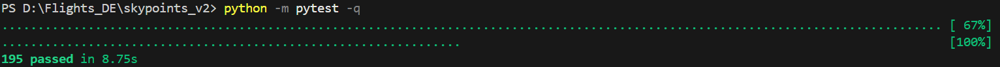

## Run it on Snowflake

```bash
python -m skypoints.snowflake_runner demo     # deploy + load samples through the real SQL + parity diff
```

Setup and credentials are in the [runbook](docs/SNOWFLAKE_RUNBOOK.md). Commands: `deploy`, `load`, `demo`,
`parity`, `security`, `purge`; add `--serial` for single-transaction country moves.

## Evidence from a real Snowflake account

Verified on Snowflake Standard edition (AWS), 2026-11-23.

**1. Full demo: SQL and Python agree.** The demo ran every step and printed `PARITY OK`: the SQL staged the
same 13 rows and raised the same reject rules as the Python oracle.

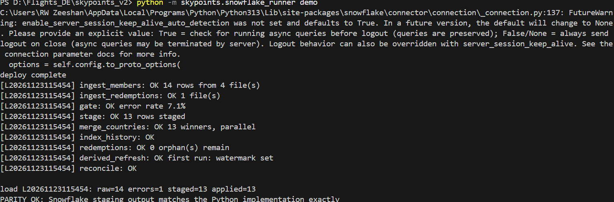

**2. Data-quality warnings and rejects** from the sample data (bad date `2021-13-13`, `AU`/`PHIL`
normalised, short IDs flagged).

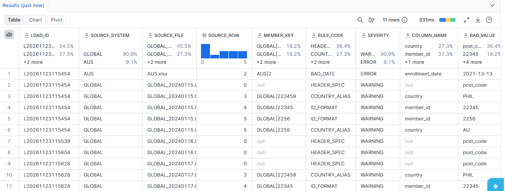
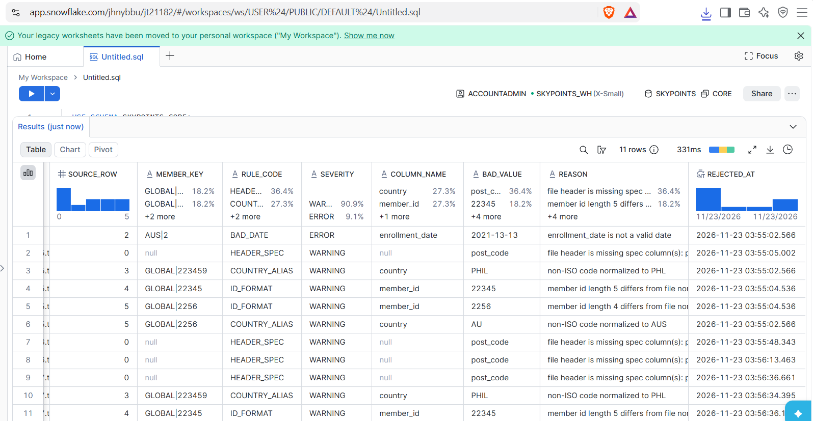

**3. A member moves country.** Day two moves Elena USA -> CAN and GLD -> PLT; she leaves the USA table.

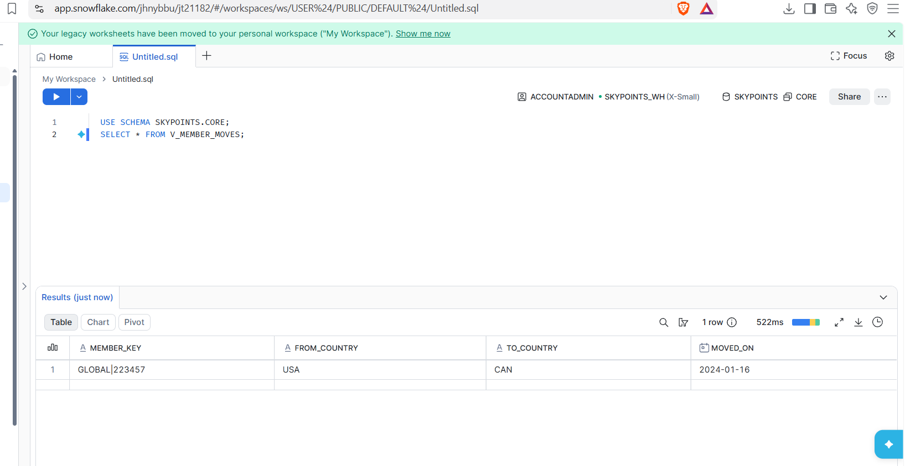

**4. History keeps both versions** (SCD2), so "what was she on Jan 15?" is answerable.

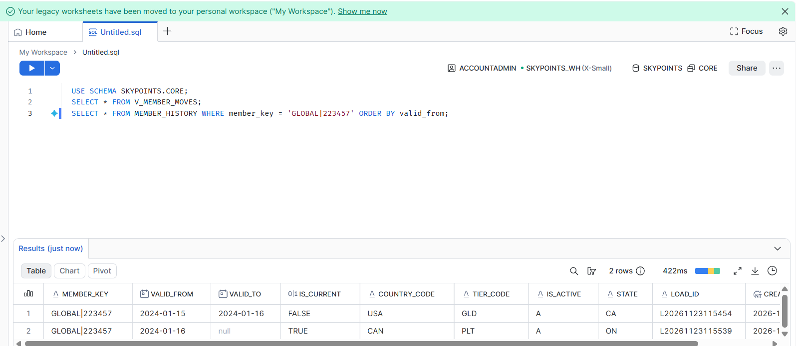

**5. Redemptions join to the member's current country**, including earlier redemptions after the move.

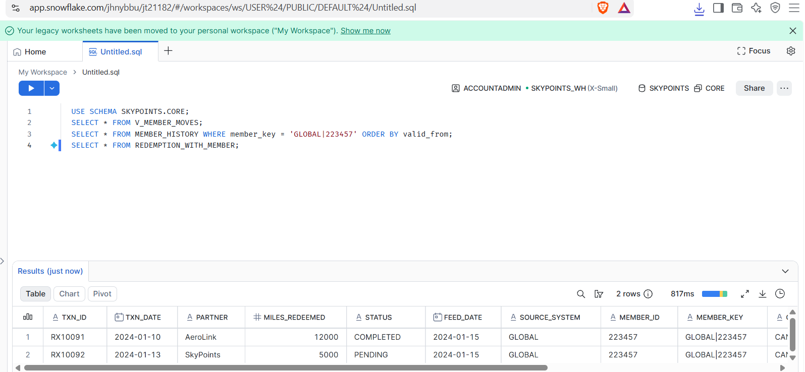

**6. Safety guard.** A truncated snapshot file is refused instead of mass-deleting members.

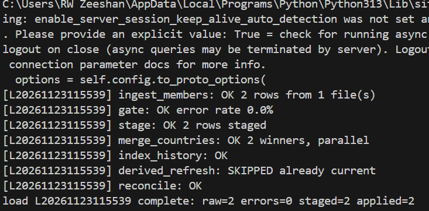
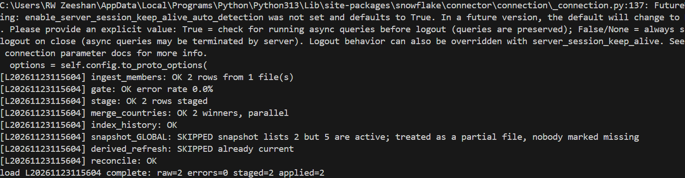

**7. Soft delete.** A complete snapshot that omits Jacob (2256) marks him `MISSING_FROM_FEED` with
`missing_since` 2024-01-17; the derived refresh then runs.

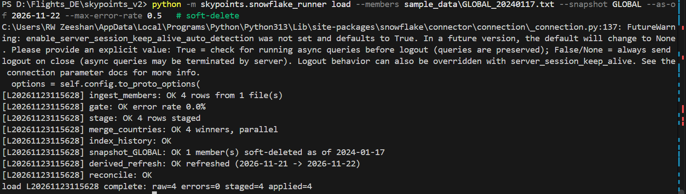
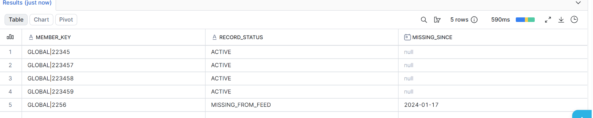

**8. Audit trail.** Run log and reconcile results for each load.

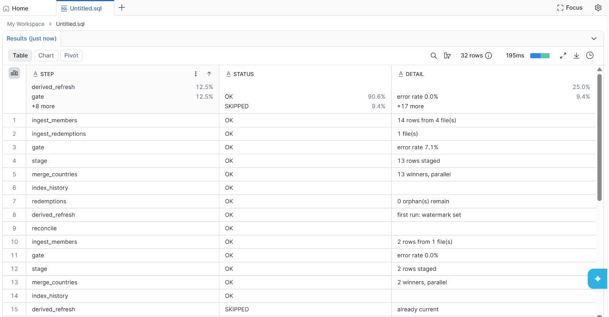
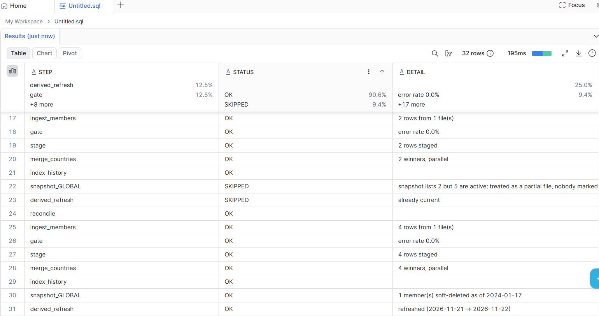

### Not verified on Snowflake

- The security layer (roles, masking, row access policies) needs Enterprise edition; the test account is
  Standard. It is covered by offline tests only.
- `purge`, `--serial`, key-pair login, and the `V_MEMBER_MATCH_CANDIDATES` view (created, never queried).
- Anything at production volume: the sample is 14 rows.

## Live-demo script (about 5 minutes)

1. `python -m pytest -q`: all green.
2. Run the local command above; open `out/STG_REJECT.csv`: the AUS row with enrollment `2021-13-13`
   is quarantined, `AU`/`PHIL` are normalised, short member ids are flagged.
3. Day two (a country move). The local command keeps no state between runs, so the move is shown by the
   test, which loads day one then `sample_data/GLOBAL_20240116.txt`:
   `python -m pytest -q -k demo_day_two -v`. On Snowflake the same story is live: run
   `load --members sample_data/GLOBAL_20240116.txt` after `demo`.
4. On Snowflake: `demo`, then the queries in the runbook section 3. Drop the database before re-running
   `demo`: the derived-refresh watermark cannot move backwards.

## Known limitations

- The SQL and Python are two implementations of the same rules; golden files and the parity query exist
  to catch drift.
- The redemption read view probes every country table by clustered key. Measure it at production volume;
  if it matters, store `country_code` on the fact.
- No Snowpipe auto-ingest or scheduler is included; loads are triggered by the runner.
- Identity matching only proposes candidates. Merging stays a human decision.
- Data residency is a legal decision; the code supports per-country controls but does not make it.

## Assumptions to confirm with the source teams

- **Member identity** is `source_system|member_id`; the sample country files all reuse IDs 1-3.
- **Dates**: IND `m/d/yyyy`; USA `mddyyyy` with the leading zero lost (left-padded to 8); AUS ISO; GLOBAL
  `yyyymmdd`, with DOB read as `ddmmyyyy` (the spec does not say: an assumption).
- **Never-flown members** (no flight date) count as stale.
- **Feed mode** per source is `delta` by default; use `--snapshot` only for confirmed full extracts.
- **Redemptions** carry no country, so they join to the GLOBAL id space unless the feed adds `source_system`.

## Spec issues to raise

Member Name (not Member ID) is marked as the key; detail rows have 10 fields where the spec lists 11
(Post Code); the staging header says `County`; DOB loses its leading zero; non-ISO country codes (`AU`, `PHIL`).